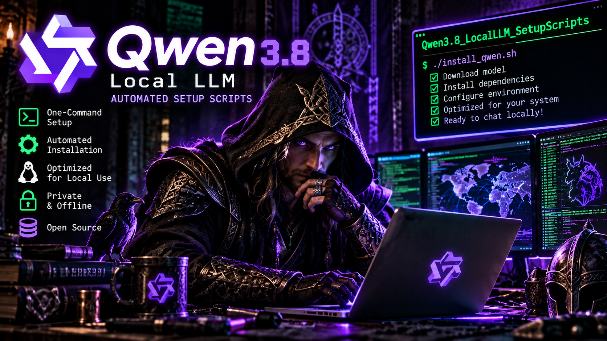

# Qwen 3.8 — Local LLM Auto Installer

**Your Hardware. Your AI. Your Rules.**

Automated setup scripts for deploying Qwen-based Large Language Models locally on Linux. Cut through the installation headaches and get straight to running your own AI.

**No cloud. No API. No subscriptions. Local AI under your control.**

---

## Features

- **Automated Installation** — Streamline model deployment and dependency setup.
- **Local AI** — Run your LLM on your own hardware.
- **GPU Acceleration** — Leverage compatible NVIDIA hardware.
- **Privacy First** — Keep your prompts and model inference local.
- **Developer Focused** — Built for coding, research, automation, and experimentation.
- **Open Source** — Inspect, modify, and customize the scripts.

## Quick Start

Clone the repository:

```bash
git clone https://github.com/B0b-Skull/Qwen3.8_LocalLLM_SetupScripts.git
cd Qwen3.8_LocalLLM_SetupScripts
```

Review the included scripts and their configuration options before execution.

Run the appropriate installer using the instructions supplied with the scripts.

## Recommended Environment

| Component | Recommendation |
|---|---|
| Operating System | Linux |
| GPU | NVIDIA CUDA-compatible |
| GPU Memory | Depends on model and quantization |
| System RAM | Depends on model size |
| Storage | Sufficient for model weights and dependencies |
| Internet | Required for initial downloads |

## Built For

**Developers. Security Researchers. AI Enthusiasts.**

Run your own AI environment for software development, cybersecurity research, experimentation, and offline inference.

## Disclaimer

Review scripts before running them. Hardware compatibility, model licensing, and installation requirements may vary. Local deployment does not automatically guarantee security or privacy.

---


[GitHub Repository](https://github.com/B0b-Skull/Qwen3.8_LocalLLM_SetupScripts)
